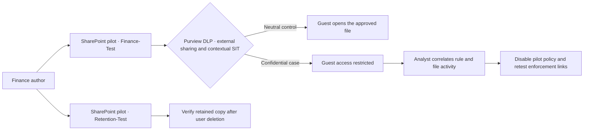

<h1 align="center">Microsoft Purview Data Protection &amp; Governance Project</h1>

<strong>SharePoint Online · Information Protection · Data Loss Prevention · Data Lifecycle Management</strong>

  
  
  

  
  
  
  

  <a href="#project-overview">Overview</a> ·
  <a href="#target-architecture">Architecture</a> ·
  <a href="#featured-implementation-evidence">Featured evidence</a> ·
  <a href="#implementation-progress">Lab roadmap</a> ·
  <a href="#supporting-documentation">Documentation</a> ·
  <a href="#security-design-principles">Security principles</a>

**Baltic Finance** needs to share routine finance documents with a partner while keeping confidential case files inside the organization. This Microsoft Purview lab uses two SharePoint documents to trace the full decision. A partner should be able to open a routine document, lose access to a classified case file when DLP takes effect, and regain access to that test file after the policy is withdrawn.

## Project Overview

The capstone compares access using the **same guest account and file links** before enforcement, during enforcement, and after rollback. An analyst correlates the policy match with the file and access attempt. A separate retention test checks whether SharePoint preserves a copy after a user deletes the live document.

The [test matrix](tests/test-matrix.csv) records **15 PASS, 1 PENDING and 8 NOT_RUN**. The tuning and holdout evaluations are complete. Microsoft 365 Business Premium is the baseline for the core SharePoint scenario. The [readiness review](docs/readiness.md#advanced-labeling-entitlement-check) records the add-on assignment and the SharePoint scope check for service-side auto-labeling.

## Explore the Project

| Architecture | Implementation | Validation | Evidence |
| :---: | :---: | :---: | :---: |
| [View control flow](#target-architecture) | [Follow the lab guide](docs/lab-guide.md) | [Open the test matrix](tests/test-matrix.csv) | [Browse evidence](evidence/README.md) |
| File classification, guest access and retention | Configuration, expected behavior, tests and rollback | Ground truth and recorded observations | Sanitized verification records |

## Technologies and Concepts

| Area | Lab scope |
| --- | --- |
| Information Protection | Custom sensitive information types (SITs), contextual matching and manual sensitivity labels |
| SharePoint DLP | Pilot-site scope, simulation, external-only access restriction and neutral-file control |
| Incident triage | Correlate the rule, file, action, actor and UTC timestamp with the observed access result |
| Data Lifecycle Management | Retain-only label, deletion from the live library and independent verification of the preserved copy |
| PowerShell reporting | Score classifier runs against labeled fixtures and report TP, FP, FN and TN once a run is complete |

## Featured Implementation Evidence

| Check | Recorded result | Evidence |
| --- | --- | --- |
| `LIC-04` · Purview portal access | The DLP Policies page opened and **Create policy** was visible | [Sanitized portal observation](evidence/README.md#dlp-portal-baseline) |
| `LIC-05` · SharePoint workload | **SharePoint sites** was selectable in the custom DLP policy wizard | [Sanitized workload observation](evidence/README.md#dlp-portal-baseline) |
| `ENV-01` · Guest baseline | The controlled guest opened the neutral document in Word for the web through named-file access | [Stage 0 screenshot 01](evidence/stage-00/01-ENV-01-guest-view-BFL-021.png) |
| `SIT-01` · Classifier setup | Created `BFL Finance Case v1` with the baseline regex at High confidence | [Baseline SIT configuration](evidence/README.md#baseline-sensitive-information-type) |
| `SIT-01` · Baseline evaluation | 20 of 20 tuning samples evaluated. 8 true positives, 3 false positives, 0 false negatives and 9 true negatives | [Tuning results](evidence/README.md#baseline-tuning-observations) · [Screenshot 04](evidence/stage-01/04-SIT-01-v1-BFL-014.png) |
| `SIT-02` · Configuration readback | The initial v2 draft was not saved as intended. The stored keyword-only pattern explained the diagnostic match and prompted a fresh evaluation | [Readback and initial observations](evidence/README.md#contextual-sensitive-information-type) |
| `SIT-02` · Corrected positive control | v2 reported case ID `BFLCASE-249898` with the supporting phrase on `BFL-006.xlsx` after the pattern was saved correctly | [Screenshot 09](evidence/stage-01/09-SIT-02-v2-retest-BFL-006.png) |
| `SIT-02` · Tuning comparison | v2 reduced false positives from 3 to 0 while detecting all 8 finance cases in the tuning set | [Tuning results](evidence/README.md#corrected-v2-tuning-run) |
| `SIT-03` · Holdout evaluation | Frozen v2 matched all 4 finance cases and returned no match on all 6 controls in the separate holdout | [Holdout results](evidence/README.md#holdout-evaluation) |
| `LBL-01` and `LBL-02` · Manual label persistence | SharePoint displayed the assigned sensitivity label for each test workbook | [Stage 01 screenshot 10](evidence/stage-01/10-LBL-01-LBL-02-sharepoint-sensitivity.png) |
| `SIM-01` · DLP simulation | The pilot site scan completed with one match across 13 files. The match was `BFL-005.docx` | [Simulation mode](evidence/stage-02/01-SIM-01-dlp-policy-in-simulation.png) · [Stage 02 screenshot 03](evidence/stage-02/03-SIM-01-BFL-005-match.png) |
| `DLP-01` · Guest baseline before enforcement | The same controlled guest opened both fixtures in view-only mode | [Stage 02 screenshot 02](evidence/stage-02/02-DLP-01-guest-view-BFL-005.png) |
| `DLP-02` · Guest access after activation | The guest received `403 Forbidden` for `BFL-005.docx` and opened `BFL-021.docx` in view-only mode | [Stage 02 screenshot 04](evidence/stage-02/04-DLP-02-guest-denied-BFL-005.png) |

The [capstone](docs/capstone.md) defines the evidence required for a policy match, guest denial, internal access, incident reconstruction and recovery.

## Target Architecture

The primary DLP rule combines external sharing with a match on the contextual SIT. If the tenant supports sensitivity-label conditions, a separate simulation tests the manual label as a trigger. The retention test uses a dedicated copy so it can be verified independently.

## Implementation Progress

| Stage | Validation milestone | Status |
| --- | --- | --- |
| 0 · Tenant readiness | Confirm base subscription, pilot accounts, guest baseline and SharePoint DLP availability | Complete |
| 1 · Classification and labeling | Compare the two classifiers and test the frozen rule on the reserved files. Verify manually applied sensitivity labels in SharePoint | Complete |
| 2 · DLP and triage | Simulate the rule, verify guest allow and deny outcomes, and correlate the policy signal | In progress |
| 3 · Lifecycle controls | Verify preservation after deletion. Exercise service-side auto-labeling if the license permits | `NOT_RUN` |
| 4 · Capstone and closure | Repeat the allow and deny cases, then verify recovery after policy withdrawal | `NOT_RUN` |

## Supporting Documentation

| Resource | Contents |
| --- | --- |
| [Tenant readiness](docs/readiness.md) | Licenses, roles and pre-deployment checks |
| [Lab guide](docs/lab-guide.md) | Configuration scope, expected behavior, evidence and rollback |
| [Synthetic corpus](fixtures/README.md) and [manifest](fixtures/manifest.csv) | 12 finance cases, 8 near matches and 10 neutral controls |
| [Classification results](tests/classification-results.csv) and [PowerShell scorer](scripts/Measure-SitClassification.ps1) | Per-file observations and reproducible confusion matrices |
| [Capstone](docs/capstone.md) and [triage runbook](docs/runbook.md) | Guest access timeline, policy attribution and verified withdrawal criteria |

## Security Design Principles

- Scope policy changes to the dedicated SharePoint pilot site and use named, authenticated links for the controlled guest.
- Record the baseline, simulate the rule and compare access with a neutral control before attributing a denial to DLP.
- Publish synthetic fixtures and sanitized evidence. Keep guest links and raw tenant exports private.

## Related Portfolio Projects

[Microsoft 365 Administration & Support](https://github.com/krzysztof-szot/m365-administration-support-project) · [Hybrid Enterprise Security](https://github.com/krzysztof-szot/hybrid-enterprise-security-project) · [IAM PowerShell Automation](https://github.com/krzysztof-szot/iam-powershell-automation-project) · [Microsoft Entra Identity & Access](https://github.com/krzysztof-szot/entra-identity-access-project)
