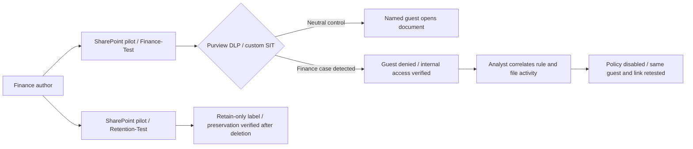

# Microsoft Purview Data Protection and Governance

Baltic Finance needs to share routine finance documents with a partner while keeping case files inside the organization. This SharePoint pilot tests whether Microsoft Purview can distinguish the two, restrict a guest's access to a confidential document, explain the decision, and restore the pre-change behavior after the policy is withdrawn.

**Status:** Lab planning and subscription review in progress. The synthetic corpus and test protocol are ready. Tenant configuration and live Purview outcomes are tracked in the [test matrix](tests/test-matrix.csv).

[Capstone](docs/capstone.md) · [Lab procedure](docs/lab-guide.md) · [License and readiness](docs/readiness.md) · [Test corpus](fixtures/README.md) · [Evidence index](evidence/README.md)

## Control flow

The first DLP rule uses the custom sensitive information type (SIT) independently of file sensitivity labels. A separate label-only test isolates that trigger if the tenant supports it. Retention is verified on a separate file copy.

## Validation

| Question | Evidence required | Current status |
| --- | --- | --- |
| Does context improve detection? | Two tuning runs and a final run on ten reserved files with TP, FP, FN and TN | NOT_RUN |
| Can the partner open neutral content while a confidential file is restricted? | Simulation result, guest session, internal control and rule attribution | NOT_RUN |
| Can an analyst reconstruct the event? | UTC time, file ID, actor alias, action, rule and observed outcome | NOT_RUN |
| Is a retain-only copy preserved after user deletion? | Label state, deletion and independently verified retained copy | NOT_RUN |
| Did withdrawal restore guest access? | Scoped policy state and a repeat test with the original guest and link | NOT_RUN |

## Reproduce the lab

1. Confirm licensed users, portal permissions, subscription dates and access to a controlled guest identity in [readiness](docs/readiness.md).
2. Follow the [lab procedure](docs/lab-guide.md) and use the [manifest](fixtures/manifest.csv) to select fixtures for each run.
3. Record observations and evidence in the [test matrix](tests/test-matrix.csv) and [classification runs](tests/classification-results.csv). Use the [PowerShell scorer](scripts/Measure-SitClassification.ps1) to produce the confusion matrices.
4. Document effective access, telemetry and rollback in the [capstone](docs/capstone.md). Follow the [incident runbook](docs/runbook.md) when investigating the DLP event.

## Portfolio context

The pilot uses the same fictional organization as the SharePoint administration, hybrid security and IAM labs. Its scope is document protection and lifecycle validation inside Microsoft 365. [Microsoft 365 administration](https://github.com/krzysztof-szot/m365-administration-support-project) · [Hybrid security](https://github.com/krzysztof-szot/hybrid-enterprise-security-project) · [IAM automation](https://github.com/krzysztof-szot/iam-powershell-automation-project) · [Entra identity and access](https://github.com/krzysztof-szot/entra-identity-access-project)
